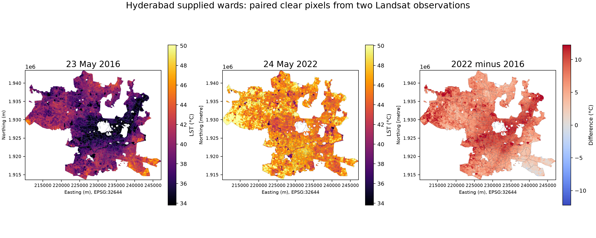
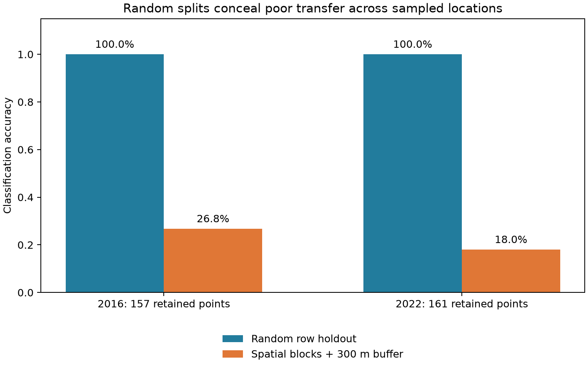

# Hyderabad Landsat surface-temperature and land-cover study

A reproducible Python upgrade of the original QGIS/notebook project. It compares **23 May 2016 and 24 May 2022**, aligns the two scenes, applies Landsat quality masks, and summarizes paired surface-temperature pixels across **145 supplied ward features**.

The upgrade exposes a substantial model limitation: random row splits achieve 100% accuracy, while spatial holdouts perform poorly. The land-cover models and transition tables remain experimental diagnostics. The temperature workflow uses the USGS Level-2 product independently of the classifier.

## Verified results

| Measurement | Reproduced value | Meaning |
| --- | ---: | --- |
| Supplied ward features | 145 | Inventory completeness has not been established |
| Paired clear pixels | 591,749 | Same locations valid on both acquisition dates |
| Paired mean LST, 2016 | 38.62 °C | Daytime land surface, supplied study polygons |
| Paired mean LST, 2022 | 46.01 °C | Same pixel support |
| Mean pixelwise LST difference | +7.40 °C | Two selected observations, not a climate trend |
| RF random holdout accuracy | 100% / 100% | 2016 / 2022, 32 / 33 test points |
| RF spatial out-of-fold accuracy | 26.75% / 18.01% | 1 km blocks, five folds, 300 m training buffer |
| RF spatial macro F1 | 0.1313 / 0.2254 | Fixed five-class label set |

The original +8.2 °C minimum-temperature and r = -0.81 causal claims are **not reproduced as stated**. Original clipped-raster minima are 21.06 °C and 29.47 °C before the new QA rules. Minima depend on masks and should not anchor a climate claim. No rural-reference UHI intensity, annual trend, or causal driver has been established.





## Quick start

Use Python 3.12. A fresh environment keeps this project's dependencies separate.

```bash
python -m venv .venv
# Activate .venv using your shell's normal activation command.
python -m pip install -e ".[dev]"
python -m pytest -q
uhi sample --output artifacts/sample
```

The bundled sample is real extracted training data and needs no network access. For the exact versions used in the checked run, install `requirements-tested-py312.txt` before installing the project.

## Full data and analysis

```bash
uhi fetch --data-root data/downloaded
uhi run --data-root data/downloaded --output artifacts/full
```

The fetch command requests the declared Kaggle **version 1** files (about 1.3 GB), verifies SHA-256 checksums and sizes, and reuses verified local files. It uses Kaggle's public download endpoint. If access rules change, obtain the same version manually from [Kaggle](https://www.kaggle.com/datasets/iith25ankit/urban-heat-island-uhi-analysis/data) and preserve its `data_raw_bands`, `processed` and `shapefiles` subfolders. Do not commit the raw imagery.

Outputs include aligned GeoTIFFs, ward statistics, experimental land-cover diagnostics, model files with feature metadata, split assignments, every holdout prediction, exact input hashes, environment versions, and figures. The checked run's compact evidence is in `results/verified_run/`; model binaries and raw rasters stay outside Git.

## Code map

| File | Responsibility |
| --- | --- |
| `src/uhi/download.py` | Pinned, verified data acquisition |
| `src/uhi/features.py` | QA bits, ST scaling, reflectance features and array contracts |
| `src/uhi/training.py` | Source band verification, labeled-point sampling, legacy baseline |
| `src/uhi/evaluation.py` | Random split, majority baseline, spatial folds and buffers |
| `src/uhi/geospatial.py` | Ward geometry, common grid, raster reads and exports |
| `src/uhi/analysis.py` | Bounded prediction batches, paired ward summaries and diagnostics |
| `src/uhi/pipeline.py` | End-to-end run, manifests and figures |
| `src/uhi/cli.py` | `fetch`, `sample` and `run` commands |

Read [methods](docs/METHODS.md), [model card](docs/MODEL_CARD.md), [provenance](docs/DATA_PROVENANCE.md), and [Hinglish learning guide](docs/LEARNING_HINGLISH.md). Legacy notebooks remain for historical study with stale outputs cleared. Their full-scene inference cells are superseded by the tested pipeline.

## Scientific scope

LST measures the surface rather than two-metre air temperature. Landsat 8 thermal sampling is natively 100 m even though the delivered grid is 30 m. Two same-season dates still differ in weather, moisture, atmosphere and surface conditions. ST_QA uncertainty rasters describe product uncertainty, not all uncertainty in a between-date comparison.

Manual labels are few and spatially clustered. Several spatial folds lack a class in training. The new QA mask also removes every 2016 water training point. Better independent labels spread across multiple locations per class are required before publishing reliable conversion estimates. No NLP, agent or production-readiness claim is made for this geospatial workflow.

Figure colour limits use paired 2nd/98th percentiles for display; saved temperature values remain unclipped. The difference map uses symmetric limits.
